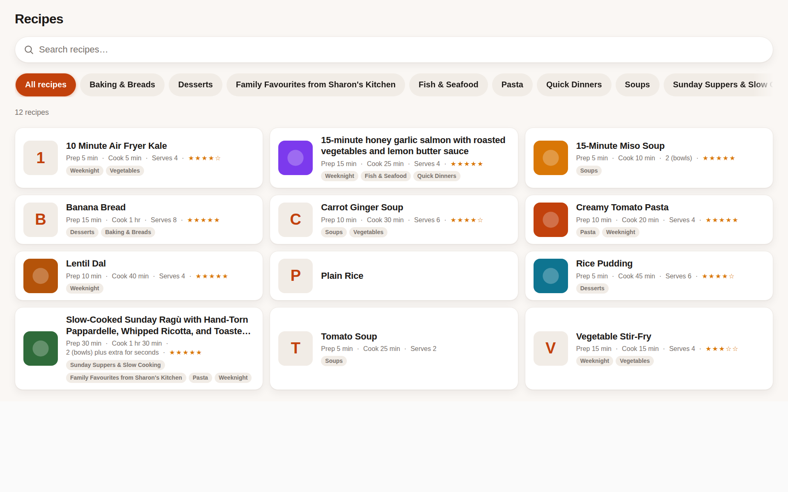

# AnyList Recipe View

A Lovelace card for Home Assistant that browses your AnyList recipes —
a searchable list, tap one to open it. That is all it does.



## What it does

- **Searchable recipe list** — a multi-column grid (landscape-first),
  with collection chips and local search. Search runs entirely in the
  browser: typing never downloads anything, and partial words find
  recipes ("carr" finds carrot recipes).
- **Tabbed detail view** — tap a recipe to open it with four tabs:
  **Ingredients**, **Recipe** (steps), **Details** (times, servings,
  rating, source), and **Notes**.
- **Ingredient headings** — section headings inside a recipe (e.g.
  "Sauce", "Topping") render as headings, never as ingredients.
- **Times shown properly** — AnyList stores prep/cook times in
  seconds; the card shows them in minutes ("5 min", "1 hr 30 min").
- **Built for a kitchen screen** — big touch targets, legible at a
  distance, usable with wet or dirty hands. No fine controls, no hidden
  menus.
- **No shopping-list button, on purpose.** The card never adds
  ingredients to a shopping list and has no button for it.

## Devices

The card adapts to the device it runs on — hub kiosk, desktop, or
phone/tablet, portrait or landscape — and re-detects on resize or
rotation. The hub (1920×1200 landscape touch display) keeps the big
kitchen-grade targets above; a desktop gets a denser layout with
smaller targets (mouse precision) and a wider detail view; a phone
gets a single column, large touch targets, full-width detail, and
collection chips that wrap onto a second row instead of scrolling
sideways. See [ADAPTIVE-LAYOUT.md](ADAPTIVE-LAYOUT.md) for the
detection mechanism (shared with the Satellite Timers card) and the
layout per device.

## How it works

The card is a single vanilla-JS file (`anylist-recipe-view-card.js`,
no dependencies, no build step, no backend of its own). It calls one
AnyList action per view-open — `anylist.get_recipes` with ingredients
and steps included — and everything after that reads from memory: the
list, the collection chips (derived from the recipes themselves), the
search, and the detail view. No per-search download, no per-recipe
download.

## Requirements

- Home Assistant 2025.12.0 or newer.
- The [AnyList integration](https://github.com/moryoav/ha-anylist)
  (AnyList by moryoav) installed and configured — the card calls its
  `get_recipes` action over the websocket API. The
  [k-mehta/ha-anylist fork](https://github.com/k-mehta/ha-anylist),
  which adds a local SQLite recipe cache, works too.

## Install

### Via HACS (recommended)

1. In HACS, go to **⋮ → Custom repositories**, add
   `https://github.com/k-mehta/ha-anylist-recipe-card` with category
   **Lovelace**, then install **AnyList Recipe View**.
2. HACS installs the card file; add it as a Lovelace resource if it
   is not added automatically: **Settings → Dashboards → Resources →
   Add Resource**, URL
   `/hacsfiles/ha-anylist-recipe-card/anylist-recipe-view-card.js`,
   type **JavaScript Module**.
3. Add a card to a dashboard with type `custom:anylist-recipe-view`
   (see below). Updates arrive through HACS.

### Manual install

1. Copy `anylist-recipe-view-card.js` from a
   [release](https://github.com/k-mehta/ha-anylist-recipe-card/releases)
   to `config/www/`.
2. Add it as a Lovelace resource: **Settings → Dashboards →
   Resources → Add Resource**, URL
   `/local/anylist-recipe-view-card.js`, type **JavaScript Module**.
3. Add the card (see below). Manual installs do not update on their
   own — repeat these steps for a new version.

## Use

Add a manual card to any dashboard:

```yaml
type: custom:anylist-recipe-view
```

The card needs no configuration and no entities. It loads the recipes
fresh every time its view is shown.

## Development

The card is one file with node tests alongside it:

```sh
node --check anylist-recipe-view-card.js
node --test anylist-recipe-view-card.test.cjs anylist-recipe-view-card.dom.test.cjs
```

## License

MIT — see [LICENSE](LICENSE).
